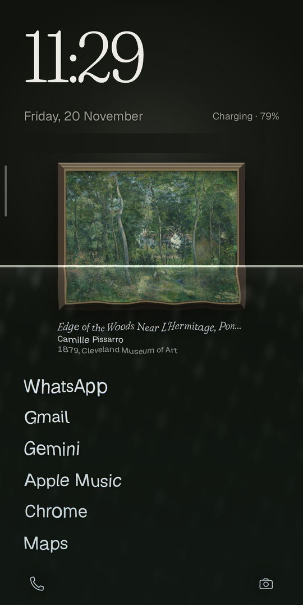
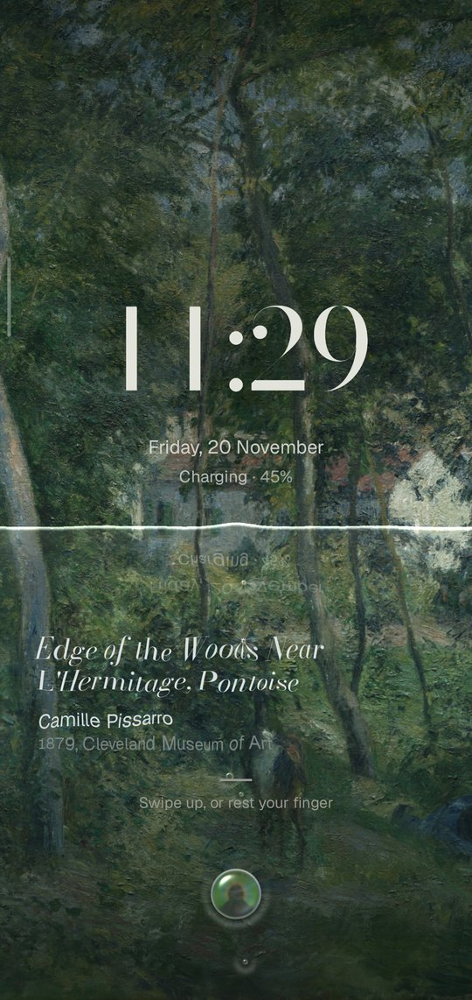
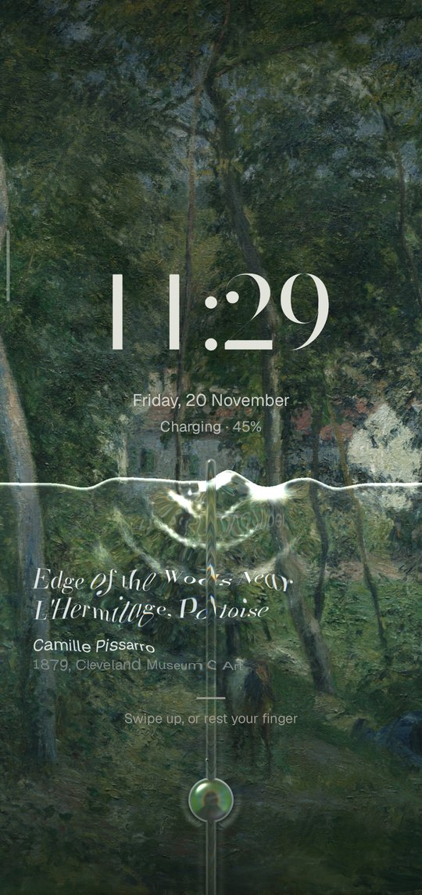

<h1 align="center">Quiet Underwater</h1>

<p align="center">
  A calm Android launcher where the home screen is water and the day's painting hangs above it.<br>
  Touch the water and it moves; leave it and it goes still.
</p>

<p align="center">
  
  
  
</p>
<p align="center"><sub>Real screenshots from a Poco F6 (HyperOS 3): Home, the Water lock screen, and the Flood as a charger is plugged in.</sub></p>

> Quiet Underwater is an edition of **[Quiet](https://github.com/devesh1905/quiet-launcher)**, a text-only launcher
> that helps you use your phone less. It's the same app with the same features, rebuilt around real water and glass
> physics. You can switch back to the classic look at any time in Settings.

## The idea

**Water is the world; the painting is the art; glass appears only where you touch.**

- **Water** floods the screen. It ripples under your finger, moves when you tilt the phone and bends whatever
  lies beneath it. On the lock screen its level is your battery.
- **The painting** hangs in a real frame with a museum label, so it reads as art, not a wallpaper.
- **Glass** is kept for things you pick up and type on: dragged apps, folders, search, sheets and the keyboard.
  There are no glass boxes or round glass buttons at rest.

## Features

### Home
- The day's painting hangs in full colour in a walnut frame on a dark gallery wall, with a museum label: title,
  artist, year and museum.
- The room is flooded. The waterline crosses the lower part of the frame and bends it, and your favourite apps
  sit under the water as plain text.
- After you unlock, one ripple spreads across the screen. A slow swell and drifting caustics play for a few
  seconds after a touch, then the water goes completely still.
- Press an app and its name rises out of the water while a ring spreads from your finger; it drops back with a
  small splash and the app opens.
- Tilting moves the water and shifts the painting slightly, so the screen has depth.
- Long-press the water to change the painting: the old one sinks and the new one rises.

### Folders and notifications
- **Folders:** hold an app and drag it onto another; the two drops merge into a folder. Tap the folder to pop
  it open. Drag an app out and it stretches, snaps and drips back into the water.
- **Notification bubbles:** each notification rises from the USB port as the app's own flat icon in a thin
  ring of water, with the count underneath. You can grab, drag and flick bubbles. Bubbles from different apps bounce off each other like balls;
  bubbles from the same app merge. Tap one to open it as a frosted card, or flick it off the bottom to
  dismiss it.

### All apps and search
- **Rail:** an A to Z rail on a glass rod, with a magnifying bead that follows your finger.
- **Search:** a glass search pill that stretches as you type.
- **Glass keyboard:** keys that press on springs, ripple the water and clink as you type. It has voice search
  and a switch to your normal keyboard.
- **Sheets:** frosted glass sheets slide over the moving water.

### Music
- **Player:**
  - The cover floats on the water and bobs with the waves.
  - The play orb is a glass drop resting on the surface.
  - You seek along the waterline.
  - Changing songs sinks the old cover while the new one rises and breaks the surface.
- **Lock screen with music:** the cover tints the painting, the light in the water and the glow around it with
  its own colours.

### Lock screen
- **Water theme:** today's painting lies under water at your battery level, with the clock reflected in the
  surface. Swiping up pulls the water away to unlock, and the fingerprint spot is a glass drop.
- **Charging styles:**
  - **Flood:** water gushes from the USB port and fills the screen to your battery level.
  - **Filling glass:** a drop on the fingerprint spot fills with liquid light.
  - **Light thread:** a glowing rope that sways and snaps.
  - **Clock fill:** the clock digits fill with liquid.
- **Charging text:** the charger tier HyperOS reports ("Charging", "Quick charging", "Fast charging" or
  "Super fast charging · 90W") with the battery percentage.
- **Show-off:** hold two fingers on the lock screen to play the Flood without a charger.

### Haptics
A small set of water and glass haptics built on the phone's own vibration primitives, all rate-limited:
- Drip when a ripple starts;
- Clink for glass, scaled by how hard it's hit;
- Plunk for merges and landings;
- Pop for splits;
- Rise when you drag glass across the waterline.

### Plus everything in Quiet
Screen time, app reminders and blocks, focus sessions, schedules, the notification filter, monochrome mode and
the daily painting. See the [Quiet README](https://github.com/devesh1905/quiet-launcher#readme).

## How it works

- **Rendering:** one AGSL `RuntimeShader`, applied as a `RenderEffect` over the live home screen, draws the water
  and up to 16 glass bodies in a single pass. Content under the water stays live and refracts.
- **Water:** two simulations run on the CPU.
  - The waterline is a spring surface of 96 columns, tilted by the gravity sensor.
  - Beneath it is a 2D ripple grid (about 90 × 190 cells) uploaded each frame as a small float texture.
  - Caustics come from the surface curvature, absorption is tinted by the painting, and the meniscus and glints
    are drawn in the same pass.
- **Glass:** each body is a signed-distance shape with a narrow dome edge and a spring body. The shading adds
  per-channel refraction, fresnel, a tight specular highlight and a rim line. Bodies in the same group merge with
  a smooth minimum.
- **Physics:** steps at a fixed 120 Hz with the time step clamped, so it feels the same at any frame rate.

### Battery

The water only animates while something moves: a touch, a tilt, a notification or a level change.
- After that, a slow swell plays at about 25 fps for a few seconds, then it stops completely: no frames, no timers.
- The gravity sensor runs only while the water is moving; otherwise a low-power accelerometer at 5 Hz watches
  for movement.
- Reduced motion or battery saver gives a single still frame.

Measured on a Poco F6 over 3 minutes of mixed use:

| | Classic Quiet | Quiet Underwater |
|---|---|---|
| Battery per minute | ~3.3 mAh | ~3.7 mAh |
| Frames drawn in an idle minute | ~3,500 | ~6 |

Home runs at about 60–75 fps on a 120 Hz screen.

## Install

1. Download `quiet-underwater-*.apk` from [Releases](../../releases).
2. Install it. It installs as its own app, **Quiet Underwater** (`app.quiet.launcher.underwater`), next to
   classic Quiet if you have it.
3. Make it your home app, then open Settings → **Permissions** and grant what you want to use.

Needs Android 13 or newer for the water and glass. On older versions, it falls back to the classic look.

**Classic switch:** Settings → Look and motion → **Underwater**. Turn it off for classic Quiet's look in the
same app.

**With classic Quiet also installed:** only the edition that is your home app runs the lock screen, focus checks
and background jobs, so you never get two prompts or two lock screens.

## Permissions

The same as Quiet. See [Permissions and why](https://github.com/devesh1905/quiet-launcher#permissions-and-why).
Replace the package name with `app.quiet.launcher.underwater` in the adb commands.

## Build

Requirements: JDK 17+ and the Android SDK (compile SDK 36). The project has two product flavors:

```bash
./gradlew :app:assembleUnderwaterRelease   # Quiet Underwater -> app/build/outputs/apk/underwater/release/
./gradlew :app:assembleClassicRelease      # classic Quiet    -> app/build/outputs/apk/classic/release/
```

The release build is signed with the debug key for personal installs. Set up your own signing config before
distributing it.

The underwater code lives in `app/src/main/java/app/quiet/launcher/feature/underwater/`:
- `engine/` holds the water, the glass bodies, the shader and the frame loop.
- The lock screen's Water theme is in `feature/lock/water/`, and the charging animations are in
  `feature/lock/charge/`.

## Privacy

No analytics, no ads, no account and no crash reporting. The only network calls fetch public-domain paintings
from museum APIs.

## Credits

- **Fonts** under the SIL Open Font License: Fraunces, Geist, Bodoni Moda, Instrument Serif, Big Shoulders Display.
- **Paintings:** public-domain works from the Art Institute of Chicago, The Metropolitan Museum of Art and the
  Cleveland Museum of Art open-access collections.

## License

[MIT](LICENSE)
